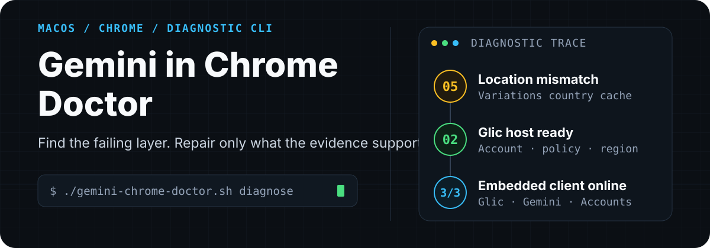

<p align="center">
  
</p>

<p align="center">
  <strong>English</strong> · <a href="README.zh-CN.md">简体中文</a>
</p>

<p align="center">
  <strong>Gemini in Chrome Doctor</strong> is a read-only-first macOS CLI for diagnosing<br>
  Ask Gemini availability, Glic location mismatch, stale Chrome Variations cache,<br>
  and embedded Gemini client network failures.
</p>

> [!IMPORTANT]
> This is an independent diagnostic tool, not an official Google project and
> not a regional-bypass utility. Location repair is allowed only when the
> detected public network country already matches the requested country.

## Diagnose Gemini in Chrome on macOS

Run one command:

```bash
./gemini-chrome-doctor.sh diagnose
```

Get a non-sensitive trace instead of guessing:

```text
== Gemini in Chrome / Glic ==
Rollout eligible: true
Ready state: 2 (Ready)

== Variations country cache ==
Current country: us
Permanent country: us
Distinct cached countries: us
Seed country conflict: false

== Network ==
Glic status API      success=3 failure=0
Gemini web           success=3 failure=0
Google accounts      success=3 failure=0
```

The script reports booleans, enums, country codes, versions, window/tab counts,
and endpoint success rates. It does **not** print email addresses, account IDs,
tab URLs, history, cookies, tokens, or Gemini conversations.

## Why Ask Gemini fails: one symptom, three layers

Gemini in Chrome is not merely a `gemini.google.com` tab. Chromium calls its
native host **Glic**. The host evaluates eligibility first, then loads Google's
embedded web client.

| Layer | Evidence | Typical next action |
|---|---|---|
| Chrome / Glic | `ready_state`, rollout, policy, account, country | Fix the exact failed eligibility check |
| Embedded client | “Something went wrong” after `Ready` | Test the Glic API and Gemini content host separately |
| Network path | Repeated endpoint success/failure counts | Switch routes or networks; do not erase the profile |

### Glic ready states

| Value | State | Meaning |
|---:|---|---|
| 0 | `UnknownError` | Unknown native-host error |
| 1 | `SignInRequired` | Chrome requires sign-in |
| 2 | `Ready` | Native eligibility checks passed |
| 3 | `Ineligible` | General eligibility failure |
| 4 | `DisabledByAdmin` | Disabled by administrator policy |
| 5 | `LocationMismatch` | Country filtering failed |
| 6 | `IneligibleAccount` | Account is not eligible |

## Install and diagnose

### Requirements

- macOS and Google Chrome;
- Bash 3.2 or later;
- `jq`;
- `curl`, `osascript`, `shasum`, and `dig` (included with macOS).

The project never installs dependencies automatically.

### Diagnose

```bash
git clone https://github.com/alloevil/gemini-in-chrome-doctor.git
cd gemini-in-chrome-doctor
chmod +x gemini-chrome-doctor.sh
./gemini-chrome-doctor.sh diagnose
```

Useful variants:

```bash
# More network samples
./gemini-chrome-doctor.sh diagnose --trials 8

# Local state only; no external network checks
./gemini-chrome-doctor.sh diagnose --skip-network-tests
```

## Safely repair stale Chrome Variations location cache

Use this only when all three statements are true:

1. the UI shows a location-availability message;
2. `ready_state = 5 (LocationMismatch)`;
3. Chrome's cached country differs from the tool's detected public country,
   and the real public country is officially supported by Google.

```bash
./gemini-chrome-doctor.sh repair-location \
  --country us \
  --apply \
  --restart
```

> [!WARNING]
> `--restart` closes Chrome. Save unsubmitted forms, editor content, and
> uploads first.

### Safety gates

- no write without `--apply`;
- no write when public country and `--country` differ;
- no force-quit when Chrome cannot exit gracefully;
- timestamped `Local State` backup before every write;
- structural hash check that rejects non-target JSON changes;
- temporary-file validation and atomic replacement;
- session restoration with `--restore-last-session`;
- runtime country override limited to the newly started Chrome process.

Only these fields are changed:

```text
variations_country
variations_permanent_consistency_country[1]
variations_safe_seed_session_consistency_country
```

Cookies, accounts, passwords, bookmarks, history, extensions, Chrome Sync,
and Gemini conversations are left untouched.

### When stale seed files restore the wrong country

If a normal repair succeeds but `diagnose` still reports multiple countries,
or Chrome restores the old country after restart:

```text
Distinct cached countries: cn,kr
Seed country conflict: true
Global seed files: Variations=present VariationsSeedV2=present VariationsSafeSeedV2=present
```

the standalone Variations seed files are repopulating stale location state.
Only then use the explicit escalation mode:

```bash
./gemini-chrome-doctor.sh repair-location \
  --country us \
  --apply \
  --reset-seeds \
  --restart
```

This mode still verifies that the real public-network country matches
`--country`, then:

1. gracefully exits Chrome and never force-quits it;
2. backs up `Local State`;
3. separately backs up global `Variations`, `VariationsSeedV2`, and
   `VariationsSafeSeedV2`;
4. removes only country and seed metadata while preserving crash/fetch counters
   and all profile data;
5. removes the three backed-up global seed originals;
6. restarts without `--variations-override-country`, forcing a genuine seed
   fetch through the current network;
7. waits up to 60 seconds for the requested country code.

It does not remove profile-scoped seeds or modify cookies, accounts, passwords,
bookmarks, history, extensions, or Gemini conversations. It refuses to run if
all cached countries already match or no global seed files exist.

## Interpret Gemini in Chrome diagnostic results

### `5 · LocationMismatch`

Compare the detected public country with Chrome's current and permanent
Variations countries. Repair only a stale mismatch. If the public network
itself is unsupported, do not modify the cache.

### `2 · Ready` + “Something went wrong”

The native host has already passed. Inspect the endpoint trials:

- Glic API stable, Gemini web unstable → investigate the route to
  `gemini.google.com`;
- several Google endpoints unstable → inspect the network, transparent proxy,
  filtering software, or upstream route;
- different DNS resolvers return the same endpoint → DNS is unlikely to be
  the root cause;
- after switching to a stable network, click **Try again** before clearing any
  browser data.

### `1 · SignInRequired` or `6 · IneligibleAccount`

- `1`: finish Google sign-in again in the same Chrome profile;
- `6`: inspect age, supervision, Workspace administration, and Gemini account
  eligibility.

### VPS/HomeIP egress prerequisite

When Google/Gemini uses a residential SOCKS or HomeIP outbound on a VPS, Doctor
can observe only the final public country and endpoint results; it cannot audit
the remote Xray configuration. A common routing bug is intending to block only
QUIC while blackholing all Google traffic on port 443:

```json
{
  "domain": ["domain:google.com", "domain:googleapis.com"],
  "port": "443",
  "outboundTag": "block"
}
```

To force TCP fallback, scope that rule to UDP:

```json
{
  "domain": ["domain:google.com", "domain:googleapis.com"],
  "port": "443",
  "network": "udp",
  "outboundTag": "block"
}
```

A following rule can then route the same domains to the residential outbound.
Without `network: udp`, the Gemini website may appear intermittently available
while Ask Gemini's TCP/443 backend is intercepted. Repair the real network path
before repairing Chrome's country cache.

<details>
<summary><strong>Real-world failure ladder: location cache → TLS route</strong></summary>

An anonymized investigation began with:

```text
Gemini in Chrome isn't available everywhere
```

The profile was rolled out, but `ready_state = 5`. Chromium source mapped that
value to `LocationMismatch`; the public network was supported while Chrome's
Variations country was stale. Repairing the cache and applying Chromium's
temporary runtime country override changed the state to `2 = Ready`.

The UI then changed to:

```text
Something went wrong
Gemini isn't available right now. Try again later.
```

Glic status and Google Accounts were stable, while TLS connections to
`gemini.google.com` failed intermittently across HTTP/1.1, HTTP/2, fixed-IP,
and multiple-DNS tests. The embedded client worked after switching to a stable
network path.

</details>

## Rollback

The repair command prints its backup path. To restore it:

1. exit Chrome gracefully and confirm the main process has stopped;
2. replace `Local State` with the printed backup;
3. start Chrome again.

```bash
cp -p \
  "$HOME/Library/Application Support/Google/Chrome/Local State.gemini-chrome-doctor-backup-YYYYMMDD-HHMMSS" \
  "$HOME/Library/Application Support/Google/Chrome/Local State"
```

`--reset-seeds` also creates matching backups for the three global seed files.
To restore them, gracefully exit Chrome first, then copy `Local State` and any
required seed backups to their original filenames. Never overwrite these files
while Chrome is running.

## Trust boundaries

- Cloudflare trace is used only to read a two-letter public-country code; the
  public IP is never printed.
- Endpoint trials carry no Chrome cookies or OAuth tokens.
- The runtime country override is a diagnostic aid, not a persistent regional
  workaround.
- `--reset-seeds` uses no runtime country override and is allowed only when the
  real public country matches.
- The tool never reads VPS credentials or modifies remote proxy routing.
- Server outages, account restrictions, and enterprise policy cannot be fixed
  by editing local cache.
- Chromium preference names may change; unexpected structures cause a safe
  stop rather than a best-effort write.

## Chromium and Google sources

- [ProfileReadyState enum](https://source.chromium.org/chromium/chromium/src/+/main:out/mac-Debug/gen/chrome/browser/glic/host/glic_webui.mojom-data-view.h)
- [Glic country filtering](https://source.chromium.org/chromium/chromium/src/+/main:chrome/browser/glic/public/glic_enabling.cc)
- [Default enabled countries](https://source.chromium.org/chromium/chromium/src/+/main:chrome/browser/glic/public/glic_enabling.h)
- [Temporary country override](https://source.chromium.org/chromium/chromium/src/+/main:components/variations/variations_switches.cc)
- [Google availability documentation](https://support.google.com/chrome/answer/17140089?co=GENIE.Platform%3DDesktop)

## Tests

```bash
./tests/test.sh
```

## License

[MIT](LICENSE)
